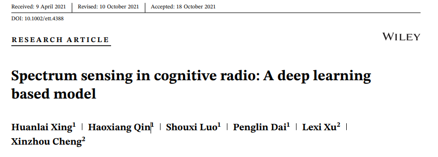
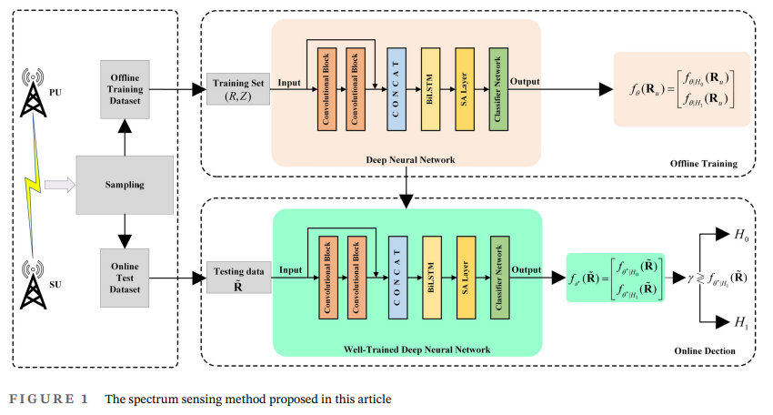
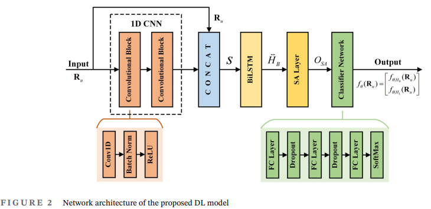
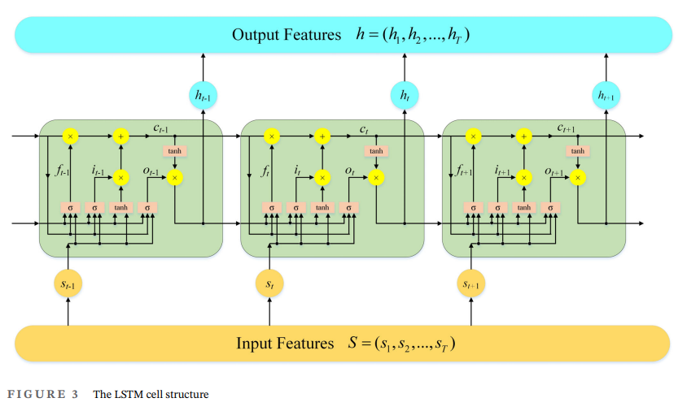
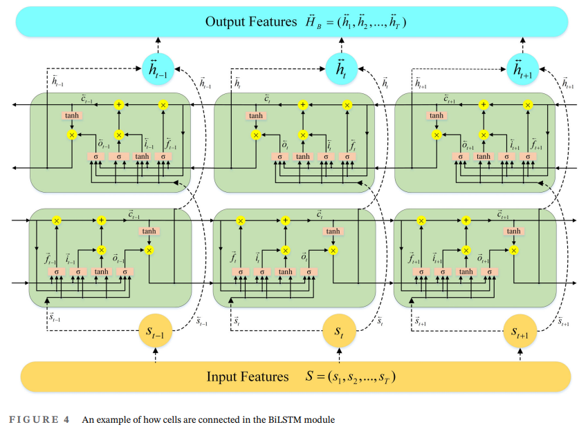
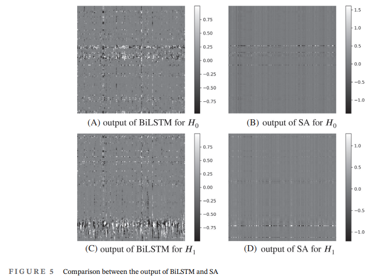
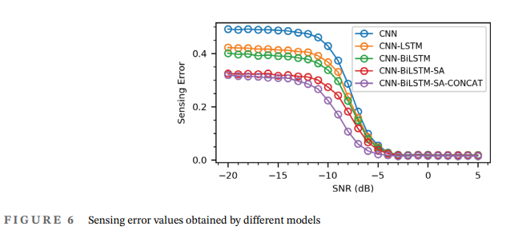
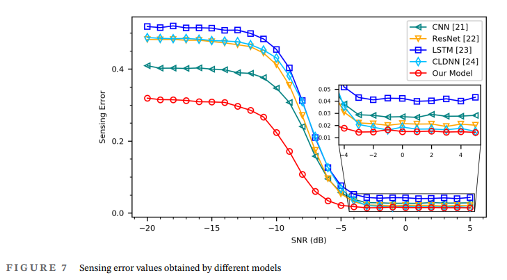
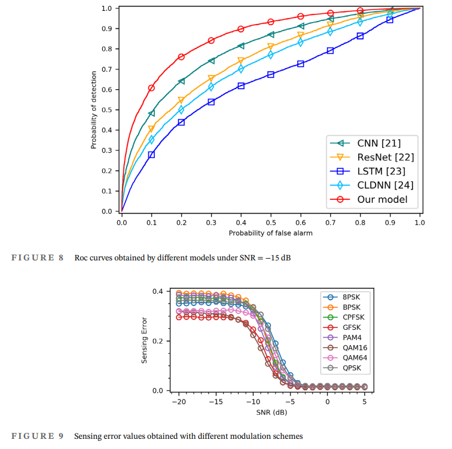
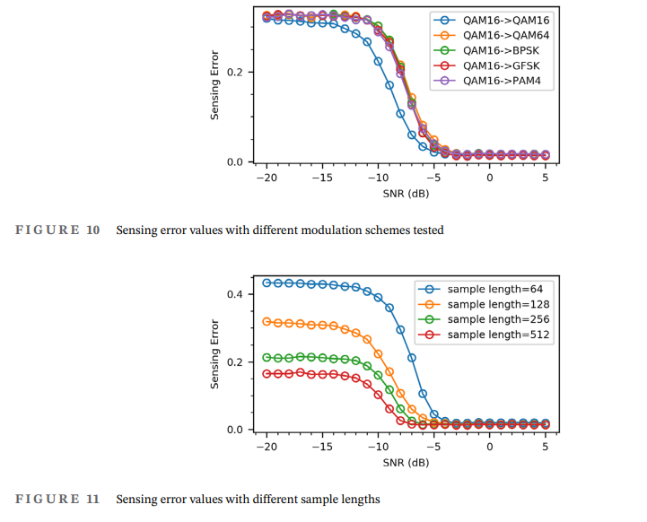

# Deep Learning-Driven Spectrum Perception: A Method and Design Exploration for Generating a Large-Scale IQ Sample Dataset with Python Code

Deep Learning-Driven Spectrum Perception: A Method and Design Exploration for Generating a Large-Scale IQ Sample Dataset
Cognitive Radio (CR) is considered one of the core technologies to address the issue of scarce spectrum resources. Spectrum Sensing, as the prerequisite for CR to function "intelligently", has been a significant research trend in the field of wireless communication. However, high-quality, large-scale, and reproducible training datasets have always been bottlenecks hindering the development of this technology.This paper is based on a research work published in "Transactions on Emerging Telecommunications Technologies", systematically analyzing the generation method, design philosophy, and key features of the large-scale IQ sample dataset for deep learning spectrum perception. The aim is to provide researchers in related fields with methodological and data-level references. Summary: Spectrum perception aims to detect the occupied status of authorized frequency bands, providing a basis for cognitive users to dynamically access spectrum.Traditional methods of energy detection, matching filtering, and cyclic steady-state detection are limited by low signal-to-noise ratio, multipath fading, and channel uncertainty. However, deep learning-based perception methods demonstrate stronger robustness and generalization capabilities by directly learning features from the received signals. Nonetheless, the performance of deep learning methods highly depends on the scale and quality of the training data.This article discusses the generation framework for a standard dataset oriented towards deep learning spectrum perception: based on a software radio simulation platform, it integrates multiple sources of digital and analog modulation schemes, dynamic wireless channel models, multipath and Doppler effects, additive white Gaussian noise injection according to the gradient of signal-to-noise ratio (SNR), as well as a pairing design of dual hypotheses (signal occupation/spectrum idleness). The final dataset consists of 26 SNR gradients, 11 modulation regimes, each combination containing 10,000 samples. The article unfolds from five aspects: problem background, related work, method design, data characteristics, and discussion prospects, systematically presenting the construction logic and key points of engineering implementation of this dataset.
1. 1.1 Study Background and Problem Proposal The explosive growth of the Internet of Things and various wireless services. The radio spectrum, an inexhaustible natural resource, is facing increasingly severe supply and demand contradictions. However, Multiple empirical studies have shown that. A large number of authorized frequency bands are in idle state at most times and in most areas. The "actual utilization rate" of the spectrum is significantly lower than the "nominal allocation rate." This "distribution tension" The structural contradiction of "using insufficiently". Cognitive radio technology was born: Cognitive radio allows unauthorized (cognitive) users to operate without causing harmful interference to authorized (master) users. Opportunistically accessing idle frequency bands, Thus, it significantly improves the efficiency of spectrum utilization.
The capability of cognitive radio is typically summarized into three stages: perception, decision-making, and reconfiguration. Spectrum perception is at the forefront, tasked with accurately determining whether a primary user signal exists within a given frequency band, distinguishing between "signal occupation (H1 hypothesis)" and "spectrum idle (H0 hypothesis). The accuracy of the perception results directly determines whether the cognitive system can achieve opportunistic access without interfering with the primary user.
1.2 Limitations of traditional spectrum perception methods The classic spectrum perception methods mainly include three categories:
Energy detection: By comparing the received signal energy with a preset threshold decision signal to determine its presence. Its implementation is simple and does not require prior information, but it suffers from the "SNR wall" effect at low signal-to-noise ratio (SNR), rapidly deteriorating perceptual performance, and being highly sensitive to noise power uncertainty.
Matching filter detection: It requires a complete mastery of the prior information such as the waveform and pilot structure of the main user signal, with harsh engineering implementation conditions and limited application range.
Circular Smoothing Feature Detection: Perception is realized by utilizing the unique circular smoothing characteristics of modulated signals. High noise resistance. However, the computational complexity is high. And similarly relies on prior knowledge of some signals.
The above method can work under ideal conditions such as channel stability, clear noise characteristics, and high signal-to-noise ratio. However, in actual wireless environments—with multipath fading, Doppler shifts, noise uncertainty, and unknown parameters of primary user signals—its perceptual performance and robustness are unsatisfactory.
1.3 The paradigm shift brought by deep learning to spectrum perception in recent years, deep learning has been widely applied in wireless communication tasks such as modulation recognition, channel estimation, and signal detection with its powerful nonlinear feature extraction and end-to-end learning capabilities. Introduce deep learning into spectrum perception, the core idea is to replace model-driven with data-driven: instead of manually designing detection statistics, the network should learn discriminative features directly from the raw representation of received signals (such as orthogonal IQ samples, power spectral density plots, cyclic prefix plots, etc.). This paradigm shift brings significant advantages including:
No need for precise signal and noise prior models, only sufficient and representative training samples are required;
Detection performance can be better than traditional methods under low SNR and complex channel conditions;
Trained networks have extremely high inference efficiency, suitable for real-time online perception.
However, a fundamental premise of deep learning methods is "data". The scale, diversity, quality of annotation, and coverage of channels directly determine the upper limit of perception model performance. Against this backdrop, building a scientific, standardized, replicable large-scale spectrum perception dataset becomes a key foundational project to push deep learning spectrum perception towards practicality.
2. Work related to Data Driven Spectrum Perception: Data Foundation for Deep Learning
Simulation-generated routes: Establish a complete "source—modulation—channel—receive" link in the software radio simulation platform, and batch generate signal samples with specified modulation regimes and noise-to-signal ratios as needed. The simulation data has advantages such as scalable controllability, precise labels, adjustable parameters, and full reproducibility, making it a mainstream data source for training deep learning models.
The benchmark significance of the RadioML series dataset lies in the simulation data. Its generation method was publicly proposed by scholars in 2016, based on a software radio platform to construct a communication signal simulation link covering various modulation regimes and a wide range of noise-to-signal ratios, and accompanying open datasets were released widely used in research on modulation recognition and signal classification. This method established several datasets generation standards that have been widely adopted in subsequent research, including:
Using text corpus as digital sources, ensuring equal probability distribution between bits and symbols after random whitening processing;
Using root raised cosine pulse shaping filters for shaping, setting reasonable number of symbol sampling points per symbol;
Introducing multipath fading, Doppler shift, and additive Gaussian white noise to simulate real channel conditions;
Representing samples in both I (in-phase) and Q (quadrature) complex numbers for easy direct use by deep learning models.
It is worth noting that although frequency spectrum perception and modulation recognition have different task definitions - the former is binary hypothesis testing (whether there is a signal), the latter is multiclass classification (different modulation methods) - they are highly isomorphic at the data level: Both rely on "signal samples under given noise-to-signal ratio and channel conditions" as the basic data unit. Therefore, the generation methodology of RadioML can be naturally transferred, adapted, and applied to frequency spectrum perception tasks, specifically manifested as: generating pure noise samples of equal length for each signal sample to form (H1 samples, H0 samples) pairs, providing directly available supervisory labels for two-class perception models. The dataset generation framework analyzed in this paper is a systematic implementation of this transfer idea.
III. Data Generation Method: System Design and Technical Key Points 3.1 Overall Framework The dataset generation framework is designed based on the overall principles of "simulation-driven, batch generation, and dual hypothesis pairing". Its workflow can be summarized as follows:
1  
Source Generation: Select statistical representative numbers and analog sources, output raw bitstream or analog waveforms.
2  
Baseband modulation: Mapping the source into a sequence of baseband complex symbols under multiple modulation regimes;
3  
Pulse shaping: Root-raised cosine filter is used to achieve shaping, controlling intersymbol interference.
4  
Channel Injection: Introduction of multipath fading, Doppler spread and time-varying characteristics through dynamic channel models.
5  
Noise overlay: Inject the corresponding power level of complex Gaussian white noise based on the target signal-to-noise ratio.
6  
Slice and normalization: Extract fixed-length segments from a continuous time series at random starting points, completing energy normalization;
7  
Paired packaging: Store signal samples and corresponding noise samples in pairs to form training data.
The above link is highly configurable at the parameter level: Signal-to-Noise Ratio, Modulation system Sample length, Number of samples Channel parameters and other settings can be independently set. Thus, it supports the generation of datasets of different scales and distributions on demand.
3.2 Design of the source and modulation scheme directly determines the statistical characteristics of signal samples. In the framework, The digital source uses the complete English text of Shakespeare's works collected in the Gutenberg Project. Read in ASCII encoding and then converted to bitstream; To ensure that symbols and bits are equally likely (which is crucial for modulation and feature learning), A random whitening (interference) step is cascaded after the source. XOR the original bitstream with a pseudorandom sequence. Remove the statistical bias caused by long strings of 0/1. This combination of "real-world corpus + whitening randomization". It ensures the authenticity of the source. It ensures the uniformity of symbol distribution.
The modulation scheme covers 11 types of systems, including both digital and analog.
Digital modulation: BPSK, QPSK, 8PSK, PAM4, QAM16, QAM64, GFSK (Gaussian Frequency Shift Keying), CPFSK (Continuous Phase Frequency Shift Keying), covering the main types from low to high order, from linear modulation to nonlinear continuous phase modulation.
Simulation modulation: Wideband Frequency Modulation (WBFM) Double sideband modulation (AM-DSB) Single sideband modulation (AM-SSB).
The design intention of this modulation spectrum is to cover as many signal forms that may appear in real frequency spectrum perception scenarios as possible. Enable the trained deep learning model to have generalization capabilities across different modulation systems. In the digital modulation link, Unified use of 8 sampling points per symbol. Root-raised cosine filter with a roll-off factor of 0.35 To achieve a balance between bandwidth efficiency and symbol intersymbol interference suppression; Different modulation systems set different emission sequence lengths based on their symbol rate characteristics (for example, higher order orthogonal amplitude modulation uses a longer sequence to ensure symbol statistical convergence).
3.3 Wireless Channel Modeling The realization of wireless channel modeling is a key source of dataset authenticity. The framework adopts a dynamic channel model, while also introducing multipath fading and Doppler effect:
Multipath structure: Three paths are set up, with their respective delays of 0, 0.9 and 1.7 symbol periods, relative amplitudes of 1.0, 0.8 and 0.3, respectively, representing direct and two different strengths of reflected paths; The multipath effect induces frequency selective fading and inter-symbol interference at the receiving end, which is one of the main channel impairments faced by spectrum perception.
Doppler Spread: The normalized Doppler shift parameter is set. Simulate the channel time-variation characteristics caused by relative motion or scattering body movement between transmitter and receiver. Enable the generated samples to have coverage for fast-changing channels;
Time-varying characteristics: The channel parameters vary slowly over time during the simulation process. Makes the same signal-to-noise ratio. There is still sufficient channel diversity between samples under the same modulation system. thereby effectively suppressing overfitting. Enhance the diversity of the dataset.
The noise superposition stage strictly controls the noise power according to the target signal-to-noise ratio: Firstly, calculate the energy of the signal segment and convert it into average power. And then back-calculate the required noise power level based on the definition of signal-to-noise ratio. Generate corresponding amplitude of the complex Gaussian white noise, A fine coverage from -20 dB to 5 dB (step size of 1 dB) was achieved. Focused description of the low signal-to-noise ratio range. It is specifically designed to address the core challenge of "weak signal detection" in spectrum perception.
3.4 Sample Slices and Energy Normalization: Continuous complex time series outputted from the simulation link cannot be directly used as input for neural networks; they need to undergo two processing steps: slicing and normalization.
Random slicing: A fixed-length (128 complex sample points) segment is extracted from a long sequence at a random starting position. The randomized slicing strategy avoids the deterministic repetition of training samples while preserving the instantaneous phase and waveform structure information of the signal.
Energy normalization: Each slice is normalized by the total energy to eliminate the energy scale differences between samples due to emission power and channel gain, focusing the network learning on the waveform structure and statistical distribution of signals rather than their absolute power levels. This design also ensures comparability among samples with different signal-to-noise ratios, providing a unified scale for organizing data based on signal-to-noise ratios.
Each sample is stored as a 128×2 two-dimensional array (with 128 points for both the in-phase and orthogonal components), in single precision floating point format, which can be directly input into convolutional neural network architectures and other deep learning frameworks.
3.5 The construction of a dual-hypothesis pairwise sample set, as a core innovative design for spectrum perception tasks, involves synchronizing the generation of corresponding pure noise samples for each signal sample: these noise samples and signal samples have identical lengths and statistical power levels, but are solely Gaussian white noise. This results in a pairwise structure of (H1 signal samples, H0 noise samples).
H1 Set (Signal Occupancy): 10,000 signal samples for each modulation scheme at each SNR level.
H0 set (spectrum idle): 10,000 pure noise samples paired with H1.
The dual hypothesis pair design provides a natural and precise supervision signal for the two-class perception model: the model does not require manual annotation, but only learns to distinguish "signal-containing IQ samples" from "pure noise IQ samples." Additionally, this design also supports further extensions in subsequent research on H1/H0 based on this foundation, such as introducing interference, narrowband signals, or time-varying noise spectra in noise samples to simulate more complex perceptual scenarios.
IV. Data Set Scale and Statistical Features
4.1 Scale Indicators Based on the above design, the dataset has the following scale indicators:
SNR Coverage: -20 dB to 5 dB, with a total of 26 gradients (step size is 1 dB);
Modulation System: 8 types of digital modulation and 3 types of analog modulation, totaling 11 types;
Class Size: Each (modulation system, SNR) combination contains 10,000 signal samples and an equal number of paired noise samples;
Sample Structure: Each sample is a 128-point complex sampling stored in I/Q dual-path, single precision floating point.
If estimated roughly by the subset of digital modulations, just 8 types of digital modulation × 26 SNR combinations could form over 2 million sample data sizes, providing ample training, validation, and testing data support for deep learning models.
4.2 Statistical Features and Quality Control To ensure data quality, the framework also includes statistical feature analysis methods designed to verify generated datasets from the following dimensions:
Energy Statistics: Calculate the average energy of samples under each (modulation, SNR) combination, verify if energy normalization is effective and whether the energy between samples converges to a unified scale;
Bias Statistics: Compute the mean of the same phase and orthogonal components of samples, check for any DC bias or carrier center offset, ensuring there are no obvious systemic biases in the signals;
Standard Deviation Statistics: Evaluate the degree of discreteness of samples, indirectly reflecting whether the statistical characteristics of channel fading and noise injection meet expectations.
These statistical verification steps are important components of the engineering quality assurance of the dataset, helping researchers identify anomalies in the generation link before using the data (such as saturation of the source, mismatched power levels, failure of normalization).
5. Discussion and Design Considerations
5.1 Why Choose Simulation Instead of Real Testing? For the research on deep learning spectrum perception, the value of simulation datasets lies in their controllability and completeness: Signal-to-noise ratio can be precisely varied by one gradient per 1 dB, channel conditions can systematically cover typical impairments such as multipath and Doppler, and modulation types can be exhaustively included in mainstream systems—all of which are either costly to implement or difficult to exhaust in real testing. Therefore, simulation datasets have become the "standard answer" for model development and benchmark testing, while real testing data is more suitable for final validation of transfer.
5.2 Consideration of Range Design for Signal-to-Noise Ratio (SNR) The upper limit of SNR is set at 5 dB rather than higher positive SNR, aligning with the task orientation of the dataset for spectrum perception: the difficulty of the perception problem lies precisely in weak signal detection under low SNR. When the SNR is high enough, energy detection can be reliably judged, and the advantages of deep learning methods no longer significantly outweigh traditional methods; within the range of -20 dB to 5 dB, deep learning models have a chance to break through the performance bottleneck of traditional methods through learning the subtle structural features of signals. Therefore, this design of SNR range faithfully reflects the essence of the task.
5.3 Balancing Diversity and Normalization The random slicing, dynamic channels, and multipath parameters ensure sample diversity; energy normalization eliminates non-informational scale differences. Both seem contradictory but complement each other: diversity ensures that the network learns the "essence of the signal," while normalization ensures that what is learned is not interfered by "power size" such irrelevant variables. This "enhanced information, removed redundancy" sample engineering idea is a universal guideline for designing high-quality datasets.
5.4 Limitations and Prospects The current framework also has directions for further development: First, the source of the simulated modulation subset uses audio corpus, which is different from the text corpus of digital modulation sources, and how to unify the characteristics of both types of sources is worth exploring; Second, although the channel model covers multipath and Doppler effects, it has not yet included more practical damages such as interference signals, pulse noise, frequency offset, and phase noise; Third, it can be considered to supplement the dataset with labeled primary user signal activity patterns (such as bursts and periodic occupation), to support the research on sequential temporal perception. In addition, cross-scene evaluations that target the generalization ability of models (trained on simulations and tested on real measurements) are also an open issue worthy of attention.
VI. Conclusion This paper systematically analyzes the generation method and design philosophy of a large-scale IQ sample dataset for deep learning spectrum perception. Based on a software radio simulation platform, this framework constructs a training dataset that is large in scale, structured, and fully replicable through systematic design including "real corpus source + whitening randomization, 11 modulation regimes, dynamic multipath Doppler channels, 26 SNR gradients, random slicing and energy normalization, dual hypothesis pairwise samples". This work also reaffirms the viewpoint that in a data-driven paradigm, the quality of the dataset itself is an important "research infrastructure", and its design profoundly influences the upper limit of model performance. Looking forward, there is hope for more open-source, standardized, and realistic channel condition datasets to emerge, jointly promoting the transition of spectrum perception from algorithmic research to engineering implementation.
References [1] Xing J, et al. Spectrum Sensing in Cognitive Radio: A Deep Learning Based Model [J]. Transactions on Emerging Telecommunications Technologies, 2021.
[2] O'Shea T, West N. Radio machine learning dataset generation with GNU Radio[C]//Proceedings of the GNU Radio Conference (GRCon16), 2016.  
[3] Haykin S. Cognitive radio: Brain-empowered wireless communications[J]. IEEE Journal on Selected Areas in Communications, 2005, 23(2): 201-220.  
[4] Yucek T, Arslan H. A survey of spectrum sensing algorithms for cognitive radio applications[J]. IEEE Communications Surveys & Tutorials, 2009, 11(1): 116-130.  
[5] O'Shea T, Hoydis J. An introduction to deep learning for the physical layer[J]. IEEE Transactions on Cognitive Communications and Networking, 2017, 3(4): 563-575.  
Copyright Notice: This article is compiled from publicly available academic materials and is solely for academic exchange and knowledge sharing purposes. The data set generation method mentioned in this article is derived from public papers; any reproduction or reference should include the original source.

## Images

<!-- PAYMENT_BLOCK -->

## Get this dataset

- Payment link (Stripe): [Buy now](https://buy.stripe.com/3cs8yP7sY87d0vu9AB)
- Payment QR code: 

<!-- /PAYMENT_BLOCK -->
